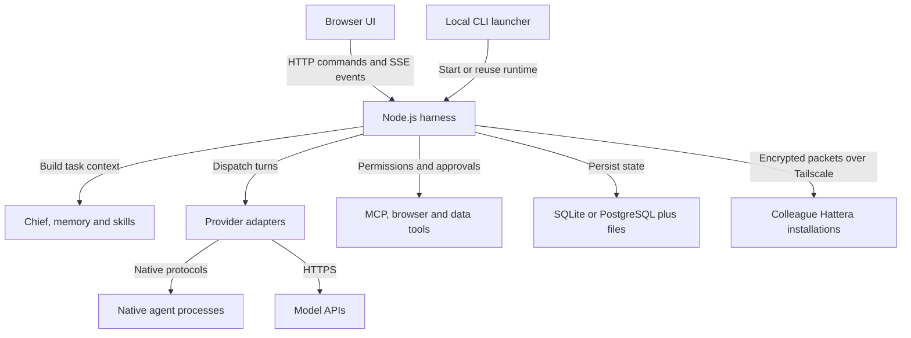

<p align="center">
  
</p>

# Hattera

**Run a team of AI agents with persistent memory, real tools and people in the loop.**

Hattera is a local-first agent workspace. Give a research bot, a coding bot and a
Chief of Staff different models, accounts and permissions, then work with them
through individual threads or shared groups. Agents keep their context between
tasks, use your configured tools, and return work to the conversation that started it.

The same workspace can connect to a colleague's Hattera over Tailscale. They keep
their accounts and execution on their machine; you choose an explicitly shared
bot/account when requesting work. Each installation remains independently operated.

[Demo](#demo) · [Capabilities](#capabilities) · [Architecture](#architecture) ·
[Team collaboration](#private-team-collaboration) · [Get started](#get-started) ·
[Development](#development) · [License](#license-and-notices)

## Demo

**Three installations. One group. Work executed through the selected owner's account.**

https://github.com/user-attachments/assets/7d905a98-7675-42ac-a4cb-eaff42bc4a12

The 2:23 recording follows Alice, Bob and Chris joining a group. Bob grants access
to a bot, Alice selects Bob's account, and Bob approves a real OpenCode request.
The reply uses information in Bob's bot memory that was not included in Alice's
prompt. Execution identity and the result are shared back to the group.

This recording uses isolated profiles and simulated Tailscale transport over a
Docker bridge, with real signed/encrypted application packets and model replies.
The maintainer separately confirmed a successful manual Tailscale group connection
on October 26, 2026. See the [test scope](docs/verification/human-groups.md#manual-tailscale-confirmation),
[recording evidence](docs/demos/three-cli-team.json), and
[reproduction guide](docs/verification/container-team.md).
[Download the original MP4](docs/demos/three-cli-team.mp4).

## The working model

| Building block | What it owns |
| --- | --- |
| **Bot** | A persistent identity with a model/account, workspace, instructions, memory, skills and tool permissions |
| **Thread** | A conversation with its own transcript, provider session, running state, approvals and usage; model overrides can stay local to that thread |
| **Group** | A shared conversation for selected bots and, when explicitly connected, human colleagues on other installations |
| **Chief of Staff** | A coordinating bot that sees its permitted roster, delegates longer tasks, receives completion/failure results and brings them back to the original conversation |
| **Account profile** | A named provider identity with separate credentials, setup state and reporting |

For example, a Chief can assign a repository investigation to a coding bot while
another bot researches the issue. Their providers execute the work through their
own adapters. The Chief stays available and receives the delegated outcomes rather
than requiring you to move every reply between chats yourself. Delegation support
depends on the selected engine and the bot's permissions.

## Capabilities

### Native agents, API models and multiple accounts

Hattera has **20 registered adapters**. The integration keeps each engine's
supported native model options, sessions, approvals and tool behavior available
through its adapter.

| Connection | Engines and providers |
| --- | --- |
| Native coding and agent engines | Claude Code, Codex, OpenCode, Cline, Gemini CLI, Kimi CLI, Grok CLI, Qwen, Hermes, Cursor, Droid, Antigravity and pi |
| API adapters | Grok, MiniMax, Mistral, Cerebras, Groq and OpenAI-compatible endpoints |
| Custom engines | User-configured ACP commands |

OpenRouter, Amazon Bedrock and other supported routes use the relevant provider
connection. They are not all separate CLI installations.

- Install, configure, repair and remove applicable managed engines from the web UI.
- Create separate account profiles for supported providers and select the account
  a bot uses. Custom ACP commands retain their explicitly configured behavior.
- Pick a model per bot or conversation, with supported native effort/model options.
- Inspect observed tokens and costs alongside provider-reported allowances,
  balances, quota windows, reset times and freshness.

Five-hour, session and weekly limits appear when the provider exposes them.
Unavailable telemetry remains unknown. Installing an engine and authorizing an
account are separate steps. The [provider matrix](docs/verification/provider-coverage.md)
records protocol coverage and reporting limits across the complete registry.

### Persistent memory with a context budget

Bot memory is inspectable Markdown in the bot's workspace. `MEMORY.md` holds the
working notes; topic files hold deeper knowledge; daily logs and archives retain
history. The Memory panel supports editing, change history and undo.

Bot memory is stored independently of provider sessions, so the same notes can
inform work across supported models without depending on one vendor's transcript.

The harness loads the first **200 lines or 24,000 bytes** of `MEMORY.md` into a
turn. Topic files are indexed and read on demand; recall adds relevant notes and
conversation passages. Managed writes can move older entries into the archive to
keep the always-loaded notes within budget. Context rebuild and compaction handle
conversation growth separately from these durable notes.

That gives you a concrete place to maintain decisions, project conventions and
reusable context across tasks. Memory belongs to the bot performing the work:
an approved request to a colleague's bot uses that bot's configured context while
its credentials and private files remain on the executing installation.

See [memory](docs/memory.md), [workspace budgets](server/workspace.ts),
[memory storage](server/memory-store.ts) and [context rebuild](server/context-rebuild.ts).

### Tools, skills and approvals

- **MCP tools:** connect local stdio servers or remote Streamable HTTP/SSE
  servers, test their handshake and enable them for compatible bots.
- **Skills:** import and review `SKILL.md` instructions, enable them per bot and
  expose a bounded skills index. Imported skills start disabled; source and content
  hashes are retained. Supporting files are outside the current import scope.
- **Browser and computer tools:** use configured browser engines and available
  native/companion components, with the relevant installation and platform grants.
- **Approvals:** preserve the provider's supported permission modes and surface
  tool requests, questions, cancellation and execution status in the conversation.
- **Hattera as an MCP server:** let another MCP client list bots, inspect bounded
  transcripts, assign work, wait for results, interrupt turns and select models.

Approval capabilities vary by provider and interface. Elevated desktop modes and
native device controls require their matching local components. Group membership,
tailnet access and provider sign-in each have separate authority.

See [custom MCP servers](docs/custom-mcp-servers.md), [skill implementation](server/skills.ts),
[approval modes](docs/approval-levels.md) and [Hattera's MCP interface](docs/mcp-server.md).

### Scheduled and event-driven work

Routines can run tasks once or repeatedly, using calendar presets or five-field
cron with an explicit timezone. The confirmation shows the timing rule and next
runs. Execution reports return to routine result threads, with links to inspect
individual runs. Repeating single-bot routines can carry a bounded summary of
their previous run for follow-ups and monitoring.

Webhook triggers feed the same queued task executor through a dedicated receiver.
The runtime must remain running for scheduled and incoming work to execute.
See [automation](apps/docs/content/docs/features/automation.mdx) and
[schedule syntax](docs/routine-schedules.md).

### Files, SQL and charts

Attach files to conversations, search transcripts, inspect rich Markdown/code
results, and use each bot's DuckDB data workspace for structured analysis. The
Data surface supports tables, SQL, charts and exports, including CSV and rendered
chart output. It uses separate bot and panel connections so UI queries can be
cancelled independently of bot work.

DuckDB serves analytical data. Conversation/configuration records and Markdown
memory have their own storage paths; they are not all stored in one database.
See the [Data engine](server/data/engine.ts) and
[attachment/search guide](apps/docs/content/docs/features/attachments-and-search.mdx).

### Voice and device access

Spoken replies support ElevenLabs, Fish Audio, built-in macOS voices and a
configured Chatterbox-compatible server. Dictation, calls, phone connections and
computer access use the corresponding native components and operating-system
permissions. Availability depends on how and where Hattera is installed.

See [voice and memory](apps/docs/content/docs/features/voice-and-memory.mdx),
[desktop companion](docs/desktop-companion.md) and [iOS companion](docs/ios-companion.md).

## Architecture

The React interface sends typed HTTP commands and consumes an SSE event stream.
The Node.js harness owns provider processes, task coordination, permissions,
context assembly and persistence. Provider credentials and process transports
stay on that server, including when the UI is opened from another device.

<!-- mermaid:id=hattera_runtime -->


### A task through the system

1. A person, routine, webhook or permitted bot starts work in a conversation.
2. The harness resolves the bot/account/model, workspace, instructions, memory,
   enabled skills and effective permissions.
3. The provider adapter starts or resumes the native/API turn. The adapters cover
   native stream protocols, Codex app-server, ACP, pi RPC and the shared API runtime.
4. Tool events, questions, approvals, partial replies and usage stream back to
   the UI. Persistence records the conversation and execution state.
5. Completion or failure settles the task. A delegated outcome returns to its
   parent conversation; a shared execution publishes a result/usage receipt.

The main boundaries are [runtime](server/runtime.ts),
[provider contracts](server/contracts.ts), [registered drivers](server/drivers/builtIn.ts),
[Chief coordination](server/chief-of-staff.ts),
[HTTP routes](server/routes/README.md) and [shared execution](server/collaboration-execution.ts).

### Storage and deployment boundaries

| Layer | Role |
| --- | --- |
| SQLite by default; PostgreSQL optional | Durable structured application records |
| Local filesystem | Bot workspaces, Markdown memory, uploads, native sessions, credentials and browser profiles |
| DuckDB | Per-bot analytical data, SQL and chart queries |
| Optional S3-compatible storage | Copies of attachments and encrypted workspace backup exports |
| Go private-network helper | App-managed Tailscale connectivity between independent installations |

PostgreSQL and object storage do not remove the need for a durable filesystem.
Provider CLIs and browser profiles need real writable paths. See
[storage and recovery](docs/storage-and-recovery.md) before choosing a hosting setup.

## Private team collaboration

Each person runs Hattera with their own bots and accounts. The group connects
those installations without requiring a central Hattera VPS.

1. **Connect the machines.** Each person connects the app-managed Tailscale node
   from **Private network** in Settings. Tailnet policies must permit reachability.
2. **Invite the people.** Create an invitation from the group's sharing panel for
   each colleague. They join from their own installation; multiple people can join.
3. **Grant execution access.** In **Shared providers and requests**, the owner
   chooses a configured bot/account and the colleagues allowed to request it.
4. **Select the executor.** Choose the owner's bot/account under **Run with**.
   Work follows the owner's configured approval policy.
5. **Track the outcome.** The task executes on the owner's machine, using that
   bot's workspace and permissions. The shared result identifies its owner/account
   and includes the usage information the executing provider supplied.

The peer protocol signs events with Ed25519 identities and encrypts packets for
their recipients. Its durable log supports queued delivery, acknowledgments,
restart/reconnect and membership revocation. Selected group text and results are
replicated; credentials and native provider sessions remain local. A disconnected
device learns a revocation when it reconnects.

**Pairing signs a device into one installation. A group invitation joins independent
installations.** Neither Tailscale presence nor group membership automatically
grants access to another person's provider account.

Read [human groups](docs/verification/human-groups.md),
[execution grants](docs/verification/shared-execution.md) and
[the peer ledger](server/collaboration-ledger.ts) for the permission and delivery model.

## Get started

```sh
git clone https://github.com/Msalways/hattera.git
cd hattera
```

### Docker: self-hosted web app

Requires Docker with Linux containers:

```sh
docker compose up -d --build
docker compose logs omb
```

Open **http://127.0.0.1:8080**. Without GitHub sign-in configured, use the initial
pairing link printed in the logs. Codes are single-use and expire after five
minutes; an authenticated owner can generate another from Settings.

Compose builds this checkout and persists application data in a named volume.
Its default engine list includes Claude Code, Codex, OpenCode and Cline. Other
supported engines have their own setup. Provider sign-in remains yours to complete.

<details>
<summary>Configure GitHub owner sign-in</summary>

Copy `.env.example` to `.env`. Set `GITHUB_CLIENT_ID`, `GITHUB_CLIENT_SECRET`,
`BETTER_AUTH_SECRET` and `GITHUB_OWNER_ID`, then use the matching public origin:

```dotenv
HATTERA_PUBLIC_URL=http://127.0.0.1:8080
GITHUB_REDIRECT_URI=http://127.0.0.1:8080/identity/callback/github
```

Register that exact callback in the GitHub OAuth application. Keep `.env` private.
The [Docker guide](deploy/local/README.md) covers OAuth, ports, existing volumes,
engine selection and proxy configuration.

</details>

### Local CLI: direct access on your computer

Requires **Node.js 24+**, **pnpm 10.33.0** and the Go toolchain specified in
[network/go.mod](network/go.mod).

```sh
pnpm install --frozen-lockfile
pnpm build
pnpm build:server
pnpm build:network --current
node dist-server/hattera.js web
```

The launcher opens the app directly on first launch and keeps a reusable runtime
in the background. Provider authorization is separate. Remote devices and
self-hosted deployments retain their authentication requirements.

```sh
# Start without opening a browser
node dist-server/hattera.js web --cli-only

# Stop the runtime
node dist-server/hattera.js stop
```

The CLI currently launches and administers the workspace. A dedicated terminal
coding harness and the proposed project/epic/worktree framework remain in development.

<details>
<summary>Install a built npm artifact</summary>

Use a tarball built from this repository:

```sh
npm install -g ./hattera-VERSION.tgz
hattera web
```

Replace `VERSION` with the artifact version. npm installs the native Data/chart
dependencies; provider engines and browser tools have their own setup. Registry
publication is a separate release step. See [npm qualification](docs/verification/npm.md)
and [publishing](docs/releasing.md).

</details>

### First conversation

Open **Model providers and accounts**, add an account and finish its supported
installation/sign-in flow or API configuration. Create a bot, choose its configured
model, set its workspace and permissions, and start a thread. Add bots to a group
when you want a shared conversation; configure Chief for delegated work.

New native workspaces use `~/.hattera`. Existing `~/.openmausbot` data is reused
without moving bots, memory, accounts or pairing state. `HATTERA_*` settings take
precedence over supported `OMB_*` aliases. Existing Docker volume names and legacy
protocol identifiers remain compatible. See [compatibility](docs/rebranding.md).

## Development

| Directory or entry | Responsibility |
| --- | --- |
| `src/` | React/TypeScript interface and client state |
| `server/runtime.ts`, `server/routes/` | Node.js harness, HTTP API and event delivery |
| `server/drivers/`, `server/contracts.ts` | Provider implementations and shared runtime contracts |
| `server/data/` | DuckDB engine, data tools, charts and exports |
| `shared/` | Wire schemas and shared types |
| `network/` | Go/Tailscale private-network helper |
| `electron/`, `companion/` | Desktop shell and device bridge components |
| `apps/docs/` | Public documentation site |
| `scripts/` | Build, release, isolated fixture and verification tooling |

Run checks against disposable fixtures, keeping personal data and credentials
out of test runs:

```sh
pnpm typecheck
pnpm lint
pnpm check:brand
pnpm i18n:check
pnpm check:contrast
npm run test:e2e
```

Use `pnpm control:hattera` for development controls. The
[E2E guide](docs/verification/e2e.md) covers fresh builds, browser preparation and
optional live-network/container checks. The [verification index](docs/verification/README.md)
separates fixture results, live calls and external-account qualification.

### Current qualification and remaining work

- **Installation:** the [October 25 npm qualification](docs/verification/npm.md#executed-qualification-25-october-2026)
  passed eight native platform/version jobs across Windows, macOS and Linux,
  x64/ARM64. This is evidence for the recorded artifact, rather than a guarantee
  about every vendor service or future release.
- **Collaboration:** the recorded container run includes real provider execution;
  the maintainer's manual test confirms Tailscale group connectivity. Broader
  device/OS, recovery and real-tailnet provider-execution qualification remains.
- **In development:** the dedicated coding harness/SDK, project documentation and
  epic/worktree orchestration, plus authorized remote attachment transfer.
- **Separate release work:** signed desktop installers, upstream installer migration
  and native mobile qualification. Provider auth and telemetry coverage vary by route.

Additional guides cover [storage/recovery](docs/storage-and-recovery.md),
[hosting readiness](docs/hattera-hosting.md), [Docker](deploy/local/README.md),
[Podman](deploy/podman/README.md), [Render](deploy/render/README.md),
[Oracle VM](deploy/oracle/README.md), [releases](docs/releasing.md) and
[contributing](CONTRIBUTING.md). The [hackathon review](docs/hackathon-nebius-review.md)
tracks the remaining Nebius/NVIDIA submission requirements.

## License and notices

Original Hattera contributions are under [MIT](LICENSE), where contributors hold
the licensing rights. Component-specific license terms and copyright notices are
documented in [LICENSING.md](LICENSING.md) and [NOTICE](NOTICE).
