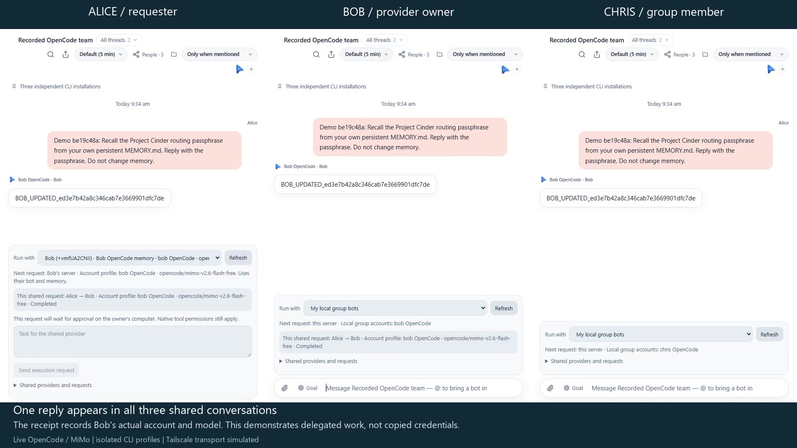

# Hattera

Hattera is a local-first workspace for running a team of AI agents. Chat with
individual bots, organize them into groups, coordinate work through Chief, and
connect models, memory, skills and tools from one browser interface.

Run it on your own computer through the local CLI launcher, or host it as a
private web application. Colleagues can connect their own installations, join
shared groups and explicitly grant access to selected bots and provider accounts.
Each installation keeps control of its own credentials and execution.

[Get started](#get-started) · [What improved](#what-this-fork-improves) ·
[Watch the demo](#watch-three-installations-work-together) ·
[Verification](docs/verification/README.md) · [Credits](#credits-and-license)

## What the project includes

| Area | Current capabilities |
| --- | --- |
| Bots and Chief | Individual bot conversations, groups, Chief coordination, task delegation and configurable bot workspaces. |
| Models and providers | Native agent integrations, API providers, custom ACP commands, per-bot/thread model selection and supported native model options. |
| Memory and context | Persistent conversations, bot memory, shared instructions, skills and context management. Shared tasks use the executing bot's configured context. |
| Scheduled work and channels | Routines, scheduled tasks, configured channels/webhooks and execution logs. |
| Files and data | Attachments, recent files, rich Markdown/code/tables, DuckDB data tools and exports. |
| Tools and approvals | Configurable tool access, MCP integrations, approval workflows, browser/computer capabilities and execution status. Platform support and setup vary by tool. |
| Accounts | Multiple named provider profiles, separate credentials, guided setup and account selection. Custom ACP commands retain their explicitly configured behavior. |
| Usage | Per-account activity, token/cost history and provider-reported quota windows, balances and reset times where available. Missing telemetry stays unknown. |
| Private collaboration | App-managed Tailscale setup, peer presence, multi-person group invitations, shared group text and owner-approved remote bot execution. |
| Local runtime | A persistent dashboard launched from the CLI, runtime discovery/reuse, graceful stop and first-launch local access without GitHub sign-in or pairing. |
| Storage and deployment | Local workspace/configuration files, SQLite-backed records, DuckDB data tools, backups, optional PostgreSQL and Docker/self-hosting configurations. |
| Interfaces | Responsive browser UI, desktop application sources and companion components. Native releases require their own packaging and platform checks. |
| Voice and devices | Speech, live calls and phone/desktop connections where the matching native components and providers are configured. |

### Provider coverage

The registry currently contains **20 adapters**. Existing integrations include
Claude Code, Codex, OpenCode, Cline, Gemini CLI, Kimi CLI, Grok CLI, Qwen,
Hermes, Cursor, Droid, Antigravity, pi and custom ACP, plus Grok, MiniMax,
Mistral, Cerebras, Groq and OpenAI-compatible API adapters.

OpenRouter, Amazon Bedrock and other supported API routes are configured through
the relevant provider connection; they are not all separate CLI installations.
See the [provider coverage matrix](docs/verification/provider-coverage.md) for the
actual execution paths, reporting support and remaining qualification.

Account allowances and Hattera-observed usage are separate. A provider may expose
five-hour, session, weekly or other windows, or expose no account-wide allowance
at all. Hattera shows supplied metrics and their freshness instead of inventing
limits from token counts. Installing an engine does not authorize its account.

## What this fork improves

The base application already provided bots, Chief, conversations, memory, tools,
skills and provider integrations. Hattera builds on that foundation:

| Improvement | What changed in Hattera |
| --- | --- |
| Product identity and UI | Hattera branding, original H mark, default skin, refreshed sign-in/onboarding and responsive browser screens. Package, CLI and desktop metadata use the fork's identity. |
| Provider lifecycle | Browser-based installation, setup, repair and managed removal for applicable engines, with dependency checks and protection for external executables and retained credentials. |
| Multiple accounts | Separate account profiles, account-specific setup and reporting, UI creation/renaming/removal and isolation from another profile's credentials. |
| Account visibility | Reporting rows for every configured account, supported native/API allowance collectors, arbitrary quota windows, freshness and explicit incomplete usage totals. |
| Private networking | An optional app-owned Tailscale connection managed from Settings, with browser authorization, connection state, peers and disconnect. |
| Human collaboration | Invitations for multiple colleagues, signed/encrypted peer communication and restart-safe shared group text across independent installations. |
| Shared provider execution | Explicit owner grants, an owner-qualified Run with selector, request approval/cancellation, execution identity and shared result/usage receipts. Credentials remain on the executing installation. |
| CLI-first local access | A background runtime reusable from any folder, direct local browser access on first launch, separate remote authentication and a normal stop command. |
| Self-hosting and auth | Fork-built Docker configuration, GitHub owner sign-in, pairing, provider authentication recovery and Render startup/health handling. |
| Verification and packaging | Isolated fixtures, browser journeys, provider/account contract tests, a three-container collaboration demo, native helper builds and standalone package checks on Windows/Linux. |

These are implemented changes with different levels of qualification. The
[verification records](docs/verification/README.md) distinguish synthetic fixtures,
recorded live calls, external-account checks and work still pending.

## Get started

### Build and run on your computer

Use Node.js 24 or later and the pnpm version declared in
[package.json](package.json). Building the private-network helper also requires
the Go toolchain declared in [network/go.mod](network/go.mod).

From the checkout root:

```sh
pnpm install --frozen-lockfile
pnpm build
pnpm build:server
pnpm build:network --current
node dist-server/hattera.js web
```

The launcher opens the dashboard and stays running after the terminal closes.
Opening it again from another directory reuses the same verified runtime.

```sh
node /absolute/path/to/dist-server/hattera.js web --cli-only
node /absolute/path/to/dist-server/hattera.js stop
```

`--cli-only` starts the local runtime without opening a browser. Configuration
and conversations are still available in the web app; this flag is not a
complete terminal coding-agent interface.

A locally launched CLI workspace enters the app directly, including on first
launch. Provider authorization is separate. Forwarded requests and other devices
still require an authenticated session.

For an npm artifact built from this fork:

```sh
npm install -g ./hattera-VERSION.tgz
hattera web
```

Use a Hattera artifact built from this repository. A public npm publication or
signed desktop release is not implied by the source checkout.

npm installs the native Data and chart dependencies automatically. Provider
engines, their account authorization and browser tools have their own setup.
See [npm installation qualification](docs/verification/npm.md) for the actual
install checks, platform release gate and remaining limits.

### Run as a self-hosted service with Docker

With Docker's Linux engine running:

```sh
docker compose up -d --build
```

Open **http://127.0.0.1:8080**. This runs in self-hosted mode: use configured
GitHub sign-in or the initial pairing link printed by:

```sh
docker compose logs omb
```

An authenticated owner can create another pairing code from Settings. Codes are
single-use and expire after five minutes. Docker/self-hosting retains its sign-in
requirement; the local CLI's direct-entry behavior does not disable it.

For GitHub sign-in, copy `.env.example` to `.env`, then configure
`GITHUB_CLIENT_ID`, `GITHUB_CLIENT_SECRET`, `BETTER_AUTH_SECRET` and
`GITHUB_OWNER_ID`. For the local Compose address, use:

```dotenv
HATTERA_PUBLIC_URL=http://127.0.0.1:8080
GITHUB_REDIRECT_URI=http://127.0.0.1:8080/identity/callback/github
```

Register that exact callback in your GitHub OAuth application. Keep `.env`
private. See the [local deployment guide](deploy/local/README.md) for ports,
pairing and proxy configuration.

### Configure providers and colleagues

1. Open **Model providers and accounts**. Add a provider/account and complete its
   supported installation and authorization flow. API and Bedrock connections
   use their respective credential forms.
2. Create or configure a bot's model, workspace, memory, skills and tool permissions.
3. For collaboration, open **Private network** in Settings and connect the
   app-owned Tailscale node. Each colleague connects their own installation.
4. Open a group's **Share group / People** panel and create a separate invitation
   for each person. Group membership alone does not grant execution rights.
5. Under **Shared providers and requests**, an owner selects a bot and allowed
   colleagues, reviews the disclosure and grants access. A colleague then selects
   that owner/account under **Run with** and sends a request for owner approval.

Tasks run on the owner's machine with that bot's workspace, context and native
tool permissions. Shared prompts and results are visible to the group. Provider
credentials are not copied to the requester. See
[shared execution](docs/verification/shared-execution.md) and
[human groups](docs/verification/human-groups.md).

## Watch three installations work together

[](docs/demos/three-cli-team.mp4)

[Watch the 2:23 side-by-side recording](docs/demos/three-cli-team.mp4): Alice,
Bob and Chris join one group; Bob grants access to a bot; Alice selects Bob's
account; Bob approves; a live OpenCode reply using Bob's private bot memory
appears in the shared conversation.

The recording uses isolated profiles and a Docker bridge that simulates
Tailscale transport. It demonstrates a live model call, not physical-device
networking or distinct paid vendor identities. It retains recorded timing,
including recovery from an expired/invalid launch link.
[Evidence and checksum](docs/demos/three-cli-team.json) accompany the video.

To reopen an existing demo, generate fresh links from its report:

```sh
node --experimental-strip-types scripts/verify-collaboration-containers.ts --links output/hattera-team-<id>/report.json --open
```

The helper starts that run's stopped containers and generates fresh one-use,
five-minute browser handoff links. Native `hattera web` opens directly; the
containerized demo needs the handoff because its browser runs outside the
container. See the [reproduction guide](docs/verification/container-team.md).

## Development and verification

The source CLI is `server/hattera.ts`. Development control is
`scripts/control-hattera.ts`; use `pnpm control:hattera` for supported commands.
Launch process-owning fixtures directly so Ctrl+C can clean up their children:

```sh
node --experimental-strip-types scripts/control-hattera.ts launch
```

Run checks against isolated fixtures, never a personal workspace:

```sh
pnpm typecheck
pnpm lint
pnpm check:brand
pnpm i18n:check
pnpm check:contrast
npm run test:e2e
```

The [E2E guide](docs/verification/e2e.md) explains fresh builds, automatic browser
preparation, reports and optional Docker/live-network checks. The
[rebrand verification record](docs/verification/rebranding.md) records 31 browser
journeys, six compiled native targets, Windows/Linux package checks and their
qualification limits. A fixture pass does not authorize a real vendor account.

## Data, compatibility and deployment

New native installations use `~/.hattera`. An existing `~/.openmausbot` workspace
is reused without moving its bots, memory, account profiles or pairing state.
`HATTERA_*` settings are canonical; matching `OMB_*` settings remain supported.
Installed legacy command aliases and protocol identifiers retain compatibility.
See the [compatibility guide](docs/rebranding.md).

The checkout root folder and existing Docker volume names remain unchanged.
Compose keeps the existing volume identities so an update reconnects the same
data. Renaming a source file does not rename or migrate a data volume.

Deployment guides cover [Docker](deploy/local/README.md),
[Podman](deploy/podman/README.md), [Render preview](deploy/render/README.md) and
[Oracle VM](deploy/oracle/README.md). The included Render preview configuration
is disposable. Durable hosting needs persistent storage for workspace files and
provider credentials as well as records, plus tested backup/restore. See
[hosting readiness](docs/hattera-hosting.md).

## Current limits and next work

- Physical multi-device Tailscale qualification and authorized attachment
  transfer are still pending; the recorded three-machine test uses simulated
  private-network transport.
- Provider login methods, model availability and account-wide quota reporting
  vary. The provider matrix records unsupported/unqualified paths rather than
  claiming every integration is interchangeable.
- The proposed project coding harness, reviewed cross-provider project
  documentation, epic/worktree orchestration and SDK are still in development.
  The current CLI is the persistent app launcher and administration surface.
- Signed desktop installers, upstream-to-fork installer migration and native
  mobile release branding need their own platform qualification. Source metadata
  changes do not establish release readiness.
- The [Nebius x NVIDIA hackathon review](docs/hackathon-nebius-review.md) records
  submission requirements and remaining gaps. The OpenCode demo does not prove
  a Nebius/NVIDIA runtime integration.

## Credits and license

Hattera is built on **[OpenMausBot](https://github.com/milind-soni/OpenMausBot)**
by **Milind Soni and the OpenMausBot contributors**. Their work supplied the base
application and much of its bot orchestration, memory, tools, skills, provider
integrations, desktop infrastructure and verification foundation. Hattera's
changes extend that work; inherited features are not claimed as original work
of this fork.

The open-source portion is distributed under [Apache License 2.0](LICENSE).
The optional `enterprise/` components retain their [separate license](enterprise/LICENSE).
Original attribution and third-party notices are preserved in [NOTICE](NOTICE)
and [LICENSING.md](LICENSING.md). Upstream services and releases are operated
separately from this fork.
