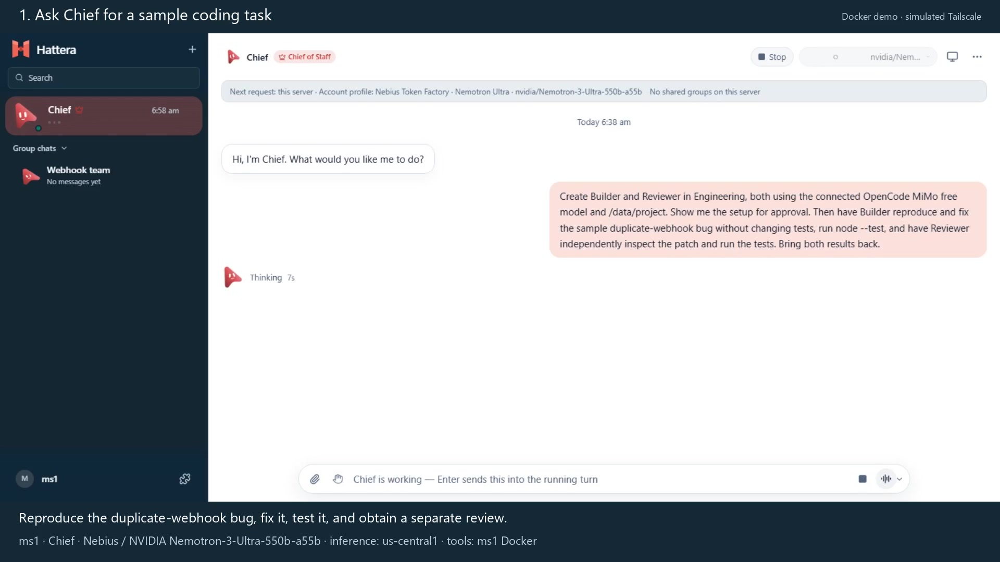

# Coding teams and shared groups: Docker tutorial

[](hattera-demo-silent.mp4)

[Download the silent video](hattera-demo-silent.mp4) — **164.833 seconds,
1920×1080 H.264, 12 fps, no audio**.

The tutorial follows `ms1`, `ms2` and `ms3` on separate Docker installations:
Chief proposes Builder and Reviewer, ms1 approves their setup, and actual coding
and review tasks return evidence. The group sequence shows invitations, messages,
sharing a selected bot, owner approval, native tool approvals and a shared result.
The whole edit labels the simulated Tailscale transport. These are automated demo
profiles; this recording does not qualify physical devices or human colleagues.

Chief uses Hattera's existing OpenAI-compatible driver with
`nvidia/Nemotron-3-Ultra-550b-a55b` through
`https://api.tokenfactory.us-central1.nebius.com/v1/`. Real Nebius receipts show
team proposals and coordination calls. Builder, Reviewer and ms2's review bot use
`opencode/mimo-v2.6-flash-free` through OpenCode 1.19.0 and OpenCode Zen. Inference
is provider-hosted; coding tools run in the identified owner's Docker workspace.
Separate demo profiles do not establish separate paid accounts.

## Artifacts and evidence

- [Recording brief](HATTERA_DEMO_VIDEO_CODEX_BRIEF.md), including the original recording commands and later audio workflow.
- [Narration script](narration.md) and [subtitles](narration.srt): 266 words, with each cue checked at an estimated 130 words/minute. Human delivery has not been recorded or measured.
- [Shot manifest](shots.json): 21 source ranges, final timings, execution identities and editorial labels.
- [Evidence](evidence.json): measured video hash, outcomes, scope and limitations.
- [Transcripts](raw/docker-transcripts.json) and [native receipts](raw/docker-native-tool-receipts.json): redacted real requests, tool activity and results.
- [Handler diff](raw/docker-ms1-fix.diff), [ms1 verification](raw/docker-final-tests.log), [ms2 verification](raw/docker-ms2-verification-tests.log), and [shared execution receipt](raw/docker-collaboration-receipt.json).
- [Original failing sample](raw/before/README.md) and the [fixed handler](fixture/src/webhook.mjs) with [unchanged tests](fixture/test/webhook.test.mjs).

The continuous screenshot takes, QA frames, private configuration and one-off
recording/recovery tools remain local. Source-directory and QA paths in the
manifests refer to that retained local set. Credentials, invitation codes and
browser profiles are excluded from this package. The earlier archived
[collaboration video](../three-cli-team.mp4) remains unchanged.

## Verified scope and limits

| Check | Outcome |
| --- | --- |
| Chief setup and delegation | Genuine proposal, Apply setup, created specialists and accepted implementation/review handoffs. |
| Reproduce, fix and test | Duplicate assertion: actual 2 invoices, expected 1. Builder added five handler lines; all three tests then passed. Tests remained unchanged on ms1 and ms2. |
| Independent review | Separate Reviewer inspected the actual patch, ran regressions and additional checks, and returned its own verdict. |
| Group collaboration | Real invitation/join, memberships, messages, a selected-bot grant and an owner-qualified execution target across Docker installations. |
| Owner permission | ms2 approved the shared request and individual native sample commands with Allow once. |
| Owner execution and replication | One successful native owner turn; the completed result appears once in each of the three shared tasks. |
| Nebius/NVIDIA | Real Nemotron setup and coordination calls through the specified Nebius endpoint. |
| Video and narration | Full video decode and format checks passed; all narration cues fit the estimated delivery rate. Human audio remains for later recording. |

Preparation, model steering, navigation retries and waits are cut. A follow-up
was needed to trigger actual Chief assignments and is visible in the edit;
printing JSON alone was not counted as dispatch. Chief queued both tasks together.
Reviewer reports that Builder's patch landed during inspection, and its completed
checks used the fixed tree. The edit does not claim serial job dispatch.

The before-fix Builder command piped output through other shell commands. The
assertion proves the failure; that surrounding shell's zero status is not the
test-process exit code. The sample fix deduplicates in memory only. ms2 received
the proposed handler through an explicit manual file copy; joining the group
does not transfer native sessions, repositories or worktrees.

Tool-result close-ups were recorded after execution and edited into the tutorial;
native timestamps preserve execution order. Actual screenshot samples are held
between captures, without invented intermediate frames. Invitation glyphs were
masked while leaving the real values and join actions unchanged.

## Verify the committed artifacts

From the repository root, with Node 24, FFmpeg and ffprobe available:

```powershell
node --test docs/demos/hattera-tutorial/fixture/test/webhook.test.mjs
ffprobe -v error -show_entries format=duration:stream=codec_name,codec_type,width,height -of json docs/demos/hattera-tutorial/hattera-demo-silent.mp4
ffmpeg -v error -i docs/demos/hattera-tutorial/hattera-demo-silent.mp4 -f null -
Get-FileHash docs/demos/hattera-tutorial/hattera-demo-silent.mp4 -Algorithm SHA256
```

The original sample under `raw/before/` intentionally fails one of three tests.
The fixed sample passes all three. Compare the measured video hash with
`video.sha256` in `evidence.json`.

For future recording, use the [brief's recording commands](HATTERA_DEMO_VIDEO_CODEX_BRIEF.md#rehearsal-and-recording-commands)
and the repository's [isolated verification workflow](../../verification/README.md).
The baseline container commands rehearse memory-based collaboration; they do not
recreate the entire coding tutorial without driving its documented UI steps.

Record the human narration after reviewing the silent edit. Run the
[audio duration guard](HATTERA_DEMO_VIDEO_CODEX_BRIEF.md#later-human-audio) before
combining speech and video: `-shortest` alone can silently cut longer speech.
This repository handoff includes no product deployment or hackathon submission.
