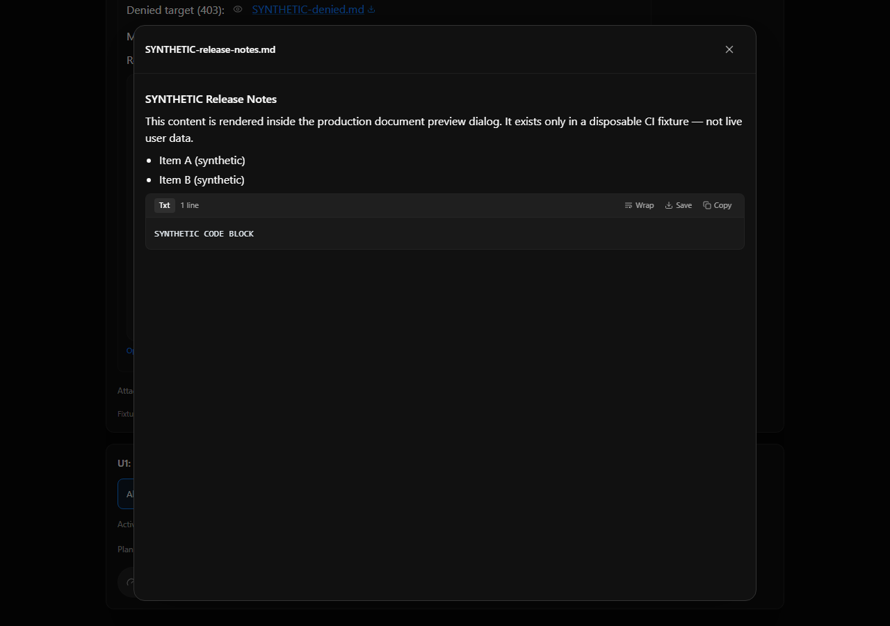
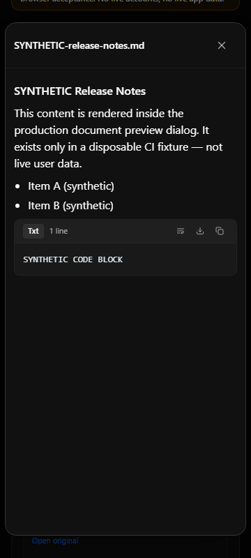
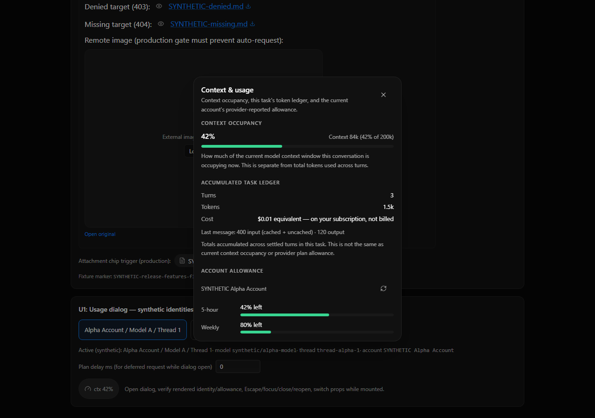
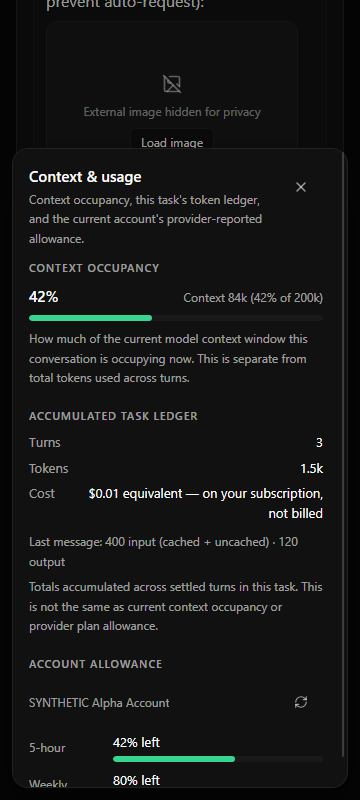

# Preview and usage browser evidence

Captured on Windows with the repository's isolated automated CDP test and a fresh Chrome profile, 2026-11-07. These are real screenshots of mounted production components with **synthetic fixture data**. They do not prove live account allowance, external provider sign-in, or packaged desktop acceptance.

Run `OMB_VERIFY_BROWSER_CHROME=<prepared executable> node --experimental-strip-types scripts/verify-release-features.ts`. The test writes its executed assertions and screenshots to `output/playwright/release-features/`; the four screenshots below are preserved from its passing run.

The candidate combines the preview and usage features from PRs #2 and #3 with release-readiness corrections. These screenshots describe this combined candidate, rather than the older PR heads.

## Preview

The browser test checks inline and attachment-chip triggers, readable markdown, close/reopen, Escape and focus restoration, distinct 403/404 errors with Retry, and external image privacy gating. File routes are synthetic; backend message authorization is a separate server-test responsibility.

## Context and usage

The browser test checks context occupancy, accumulated task ledger, provider allowance, dialog close/reopen and focus, mounted identity changes, a delayed refresh during identity switching, and 360px bounds. Fixture values (42%, 67%, and monetary values) are fictional. Shared-cache tests additionally exercise sequential authenticated account changes, sign-out, stale responses, polling failures, and timer cleanup.

The compact dialog scrolls internally on narrow screens. Live provider/account persistence, packaged Electron interaction, macOS/Linux execution, and Docker acceptance need their own candidate-bound evidence; these images do not establish those outcomes.
